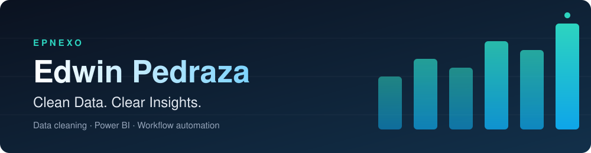
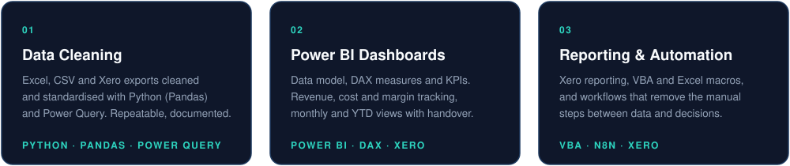
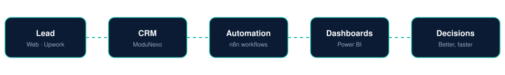
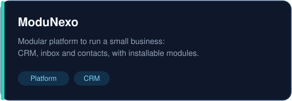
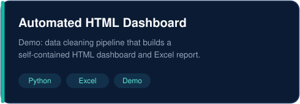

 

I help growing businesses turn messy spreadsheets and raw exports into numbers they can trust, so they can make better decisions, faster. I work directly with clients: no agency layers, fixed-price projects, documentation with every delivery.

## What I do

## How I run my own business

I use the same approach I sell. My own pipeline runs on a self-hosted stack, from the first lead to the numbers I use to decide.

## Featured work

<table>
  <tr>
    <td width="50%"></td>
    <td width="50%"></td>
  </tr>
</table>

Demo projects use sample data, not client data.

## Toolbox

## Work with me

Projects can start small: one dataset or one dashboard.

**[Start a project](https://epnexo.dev/en/start)** · **[Contact](https://epnexo.dev/en/contact)** · **[Website](https://epnexo.dev/en)**
